  
  
  
  

<b>The community store for lets uniques.</b> 
A git repository whose <code>index.json</code> lists <i>uniques</i>: rich interactive windows that <a href="https://github.com/offensiveadhd/lets">lets</a> opens in a browser pane so a human can talk to Claude graphically.

  <a href="#what-is-in-the-store">What is in the store</a> ·
  <a href="#adding-this-store">Add this store</a> ·
  <a href="#how-a-unique-gets-here">How a unique gets here</a> ·
  <a href="#the-index">The index</a> ·
  <a href="#what-verified-means">Verified</a> ·
  <a href="#submitting-a-unique">Submit yours</a> ·
  <a href="#security-model-summary">Security</a>

A unique is a STATIC web app: plain HTML, ES-module JS and CSS. No build step,
no CDN, no server-side code. Each unique speaks the LIP protocol (see
`protocol/LIP.md` in the lets repo) through two SDK files the host serves at
`/sdk/lets-client.js` and `/sdk/lets-shell.js`. Because the host never executes
unique code, it only serves static files and routes JSON envelopes,
third-party uniques are safe to install straight from a git URL.

The look of the whole ecosystem is "deep violet": dark purple backgrounds,
soft violet/magenta glows, rounded everything. Stores stay out of the way and
just point at repos; the branding lives in the uniques themselves.

## What is in the store

Six uniques today. Each row is one entry of [`index.json`](index.json); the
pictures are recordings of the real windows, kept in the uniques' own
repositories.

<table>
  <tr>
    <td width="33%" valign="top">
       
      <b><a href="https://github.com/offensiveadhd/lets-unique-graph">graph</a></b>: talk in diagrams. 
      Draw flows and ideas; the companion and Claude read and edit the same board. Installed by default with lets. Verified.
    </td>
    <td width="33%" valign="top">
       
      <b><a href="https://github.com/offensiveadhd/lets-unique-den">den</a></b>: Doto's home. 
      See what the companion learned about you and edit or forget any of it by pointing. Installed by default with lets 0.6.0. Verified.
    </td>
    <td width="33%" valign="top">
       
      <b><a href="https://github.com/offensiveadhd/lets-unique-cocode">cocode</a></b>: talk in code. 
      Type in any language, even one that doesn't exist: Claude predicts your next lines as a ghost, builds the real program ahead and runs it. Verified.
    </td>
  </tr>
  <tr>
    <td width="33%" valign="top">
       
      <b><a href="https://github.com/offensiveadhd/lets-unique-mors">mors</a></b>: talk in Morse. 
      One key, one tape: key your message in dots and dashes and send it to Claude, who reads it as a prompt. Verified.
    </td>
    <td width="33%" valign="top">
       
      <b><a href="https://github.com/offensiveadhd/lets-unique-template">pulse</a></b>: a dial you talk through. 
      The template unique: a mood dial with three modes; the companion reacts. Start here to build your own. Verified.
    </td>
    <td width="33%" valign="top">
      <b><a href="https://github.com/alon-hoffman/lets-unique-tweak">tweak</a></b>: an inspector for any codebase. 
      Say what to tweak ("player movement", "the scoring"): Claude finds the values once, then sliders, toggles and color pickers edit your source files through a small local agent with no further AI calls. Needs Node 20+ for the agent. By <a href="https://github.com/alon-hoffman">alon-hoffman</a>, the first unique from the community. Pinned to a commit; not verified yet.
    </td>
  </tr>
</table>

Install one with `/lets store <name>`: you see the manifest and its
permissions first, and nothing is installed until you say yes.

## Adding this store

In Claude Code (with the lets plugin loaded):

    /lets store

and pick `lets-store`, or ask Claude to use the `store add_store` tool:

    store add_store { "name": "lets-store", "repo": "https://github.com/offensiveadhd/lets-store.git" }

Then install any listed unique by name, e.g. `graph`, and open it in a window.

## How a unique gets here

The store holds no code. An entry points at a git repository. When someone asks
for a unique, the lets engine clones that repository into a staging folder,
validates it and shows what it declares. It is copied into `~/.lets/uniques`
only after they say yes.

## The index

`index.json` is the whole store. Every entry has these fields:

| Field | Meaning |
|---|---|
| `name` | Unique id, `^[a-z][a-z0-9-]{1,31}$`, must match the unique's manifest `name`. Unique within the index. |
| `title` | Human title shown in listings. |
| `description` | One line: what the human does with it. |
| `repo` | Git URL the host clones from. MUST be `https://…`, `git@…` or `ssh://…`. |
| `path` | Folder inside the repo that contains the unique's `unique.json` (empty string = repo root). |
| `ref` | Branch or tag to track (default `main`). |
| `sha` | Optional commit pin. When present, the host clones exactly this commit instead of moving with `ref`. |
| `manifestSha256` | Optional SHA-256 of the unique's `unique.json` file: lets the host detect a manifest that changed since review. |
| `verified` | See the policy below. `true` = reviewed by a store maintainer. |
| `tags` | Free-form discovery tags. |
| `author` | GitHub handle of the unique's author. |

## What "verified" means

An entry marked `"verified": true` has had its manifest reviewed by a store
maintainer, who checked that:

- the manifest validates against the LIP unique schema (`unique.schema.json`);
- the unique is static-only: HTML/JS/CSS, ES modules, no build step, no
  executables, no binaries, no network CDN references;
- every event/command type declared starts with a domain the unique owns
  (no reserved `lip.*`, `session.*`, `entity.*`, `chat.*`, `component.*`,
  `media.*`, `ui.*` domains);
- every permission it needs (`fs.write`, `net`) is declared in the manifest,
  so the host can show the user what the unique may do before it is served.

`verified` is a review mark, not a cryptographic guarantee. Users still see the
manifest and its permissions when they install. Pinning `sha` (and ideally
`manifestSha256`) freezes the reviewed content so a later push to the branch
cannot silently change what was reviewed.

## Submitting a unique

1. Build your unique as its own git repo (or a folder in one). See the
   [lets-unique-template](https://github.com/offensiveadhd/lets-unique-template)
   repo for a minimal working example.
2. Validate the manifest with the lets engine:

       node <lets>/engine/bin/lets.mjs validate <your-unique-dir>

3. Fork this store, add an entry to `index.json` (keep entries sorted by
   `name`), update the top-level `updated` date.
4. Run the store validator:

       npm run validate

5. Open a PR. The checklist in [CONTRIBUTING.md](CONTRIBUTING.md) must be
   satisfied; CI runs `node scripts/validate.mjs` on every push and PR.

New entries land unverified (`"verified": false` or omitted). A maintainer
reviews the manifest and flips the flag in a follow-up commit.

## Security model (summary)

- Uniques are **static**: the host serves files, never executes them.
- Everything is served from **loopback** with a per-host random token; pages
  get a CSP of `default-src 'self'`, so no external CDN, no inline exfiltration.
- The host **never runs unique code server-side**; all logic runs in the
  browser pane and talks LIP JSON over loopback HTTP/SSE.
- Permissions (`fs.write`, `net`) are declared in the manifest, validated
  before a unique is served, and enforced by the host: uploads land only under
  `~/.lets/uploads/<unique>/` and are size-capped.
- Message types are namespaced by domain; a unique cannot forge another
  unique's or the shell's messages.

See `protocol/LIP.md` in the lets repo for the full protocol and threat model.

Two things lets 0.7.0 added that the list above predates

The summary above describes a web unique. Since lets 0.7.0 a unique can also
ask for more, and both are declared in its manifest and shown before install:

- **A native view** (`native.entry`): one script the lets host runs in a
  `node:vm` context to draw the unique as a pane inside Claude Code. That is
  isolation, not a security boundary, so install a unique with a native view
  only from an author you trust.
- **`exec`** under `permissions`: the languages the unique may ask the engine's
  local runner to run for you, after you allow it on that machine.

The details are in the lets repo:
[SECURITY.md](https://github.com/offensiveadhd/lets/blob/main/SECURITY.md),
[docs/NATIVE.md](https://github.com/offensiveadhd/lets/blob/main/docs/NATIVE.md) and
[docs/RUNNER.md](https://github.com/offensiveadhd/lets/blob/main/docs/RUNNER.md).

## Repo layout

    index.json                     the store itself
    schema/store-index.schema.json JSON Schema for the index
    scripts/validate.mjs           zero-dependency validator (schema + invariants)
    .github/workflows/validate.yml  CI: validate on every push/PR (Node 20)
    assets/                        what this README shows: the banner, the logo, the diagram

## License

MIT, see `LICENSE`.
